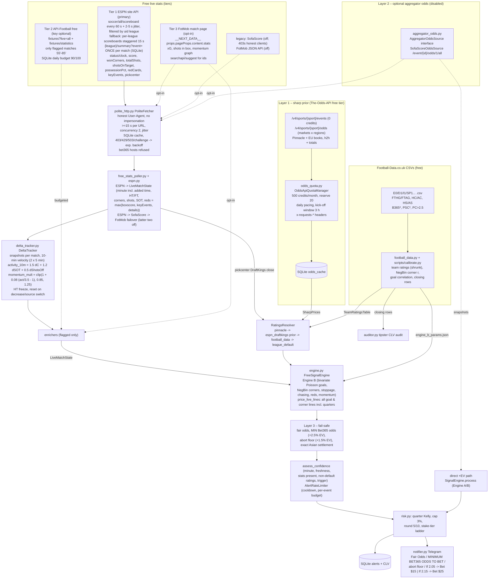
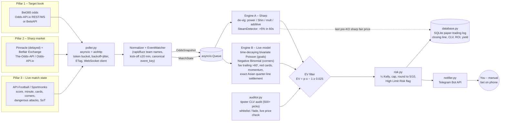

# QuantBet – Architecture ($0/month free mode)

QuantBet is a **read-only Quantitative Signal & Notification Engine**. It never
logs into Bet365 (or any bookmaker), never automates a browser, never places
bets and **never sends any request to a bet365 domain** (enforced in
`polite_http.assert_allowed_url`). You place every bet manually on your phone.

Free mode (`QB_MODE=free`, the default) costs $0/month: free public stats
(ESPN primary, optional API-Football free tier and FotMob page enrichment),
the free tier of The-Odds-API (500 credits/month), free Football-Data.co.uk
CSVs and a free Telegram bot.

## Data flow



## The three layers

1. **Layer 1 – The-Odds-API free tier (`odds_quota.py`).** `/events` is free and
   tells us kick-off times; `/odds` is only called for a sport when a fixture
   starts within `QB_ODDS_PRIORITY_WINDOW_H` (default 3 h), the last snapshot is
   older than `QB_ODDS_MIN_REFRESH_S` (3 h) and the paced budget allows it
   (`(remaining - reserve) / days_left` per day). One call with `h2h,totals`
   and ≤ 10 bookmakers costs 2 credits, so 500 credits ≈ 240 calls/month after
   the reserve. Responses and the `x-requests-*` headers are stored in SQLite,
   so restarts never re-spend credits. These near-kick-off Pinnacle prices are
   de-vigged into pre-match goal ratings for Engine B.
2. **Layer 2 – optional aggregator odds (`aggregator_odds.py`).** A
   `AggregatorOddsSource` protocol; one adapter for SofaScore's event-odds
   widget, **disabled by default**. Which bookmaker SofaScore shows depends on
   region/provider id; set `QB_SOFASCORE_ODDS_LABEL=bet365` only if you have
   verified it. When it delivers prices, the classic `SignalEngine` runs the
   direct +EV path. Flashscore/OddsPortal adapters are deliberately not
   implemented.
3. **Layer 3 – minimum-odds fail-safe (`engine.py`).** Without a live Bet365
   price, the engine never claims a price exists. It publishes the **minimum**
   Bet365 odds for +2.5 % EV and an abort floor (+1.5 % EV). You check the app
   and bet only if the price shown is at least the minimum.

## Live-stats tiers

* **Tier 1 – ESPN (`espn.py`).** Verified field names (real responses, 25 Oct 2026):
  scoreboard `events[].status{clock (s), displayClock ("43'", "45'+2'", "90'+4'"),
  period, type{name STATUS_SCHEDULED/STATUS_FIRST_HALF/STATUS_HALFTIME/
  STATUS_SECOND_HALF/STATUS_FULL_TIME, state pre/in/post}}`,
  `competitions[0].competitors[]{homeAway, team.displayName, score, statistics[]}`
  (the scoreboard already carries `wonCorners, totalShots, shotsOnTarget,
  possessionPct, foulsCommitted`) and `details[]{type.text "Red Card", redCard,
  team.id, clock}`. Summary: `boxscore.teams[]{homeAway, statistics[]{name,
  displayValue}}` (adds `redCards, yellowCards, saves, offsides, blockedShots…`),
  `header.competitions[0].status`, `keyEvents[]{type.type goal / yellow-card /
  red-card / halftime / …, clock.displayValue, team.displayName}`, and
  `pickcenter[0]` (DraftKings `moneyline.{home,draw,away}.close.odds`,
  `total.{over,under}.close`, `overUnder`). Minute = `displayClock` base+added
  if present, else `clock/60`; HT -> (45, period 2); `post` -> ended. Red cards =
  max(boxscore `redCards`, keyEvents `red-card`, scoreboard `details.redCard`).
  Live keyEvents can be sparse, so the stat and scoreboard details come first.
* **DeltaTracker (`delta_tracker.py`).** Per-match snapshots. Velocity over the
  last 10 match minutes (anchors at ≤ m−10 and m−5). The window counts are
  scaled to a 10-minute rate, or use whole-match averages when the span is
  under 3 minutes. `activity_10m = 1.5·ΔCorners + 1.2·ΔSOT + 0.5·ΔShotsOff` per
  team, with `ShotsOff = max(0, shots − SOT)`.
  `momentum_mult = clip(1 + 0.08·(activity/baseline − 1), 0.85, 1.25)`, where
  the baseline is 1.75 per team or 3.5 combined. These are
  `LiveMatchState.momentum_mult_home/away/total`, and Engine B `_momentum`
  returns them directly. That is the only live-pressure path. The dominance
  index (`attack_momentum`, synthetic) is used only for triggers.
* **ESPN `all` scoreboard (`espn.split_all_scoreboard`).** The payload has
  `leagues: [{}]`, so the league comes from `events[].uid`
  (`s:600~l:<id>~e:<event>`). IDs: 700 eng.1, 740 esp.1, 720 ger.1, 730 ita.1,
  710 fra.1, 775 uefa.champions, 776 uefa.europa (verified against the
  per-league `leagues[0].id`). Live and finished events carry the same
  `competitors[].statistics`. Pre-match events have none. If a live target
  event has no stats, the poller falls back to that league's scoreboard.
* **Tier 2 – API-Football free (`api_football_free.py`).** `interest_flags`:
  minute 55–85 and (favourite level/trailing, corners/min ≥ 1.3 × expected, or
  a red card). One `live=all` per 5 min and one `statistics` per fixture per 5
  min, ≥ 7 s apart. `ApiFootballBudget` counts calls per UTC day in SQLite,
  synced with `x-ratelimit-requests-remaining`, and stops at 90. An `errors`
  payload (plan/season/limit) disables Tier 2 until the next UTC day.
* **Tier 3 – FotMob page (`fotmob_page.py`).** `searchapi/suggest` → match id →
  `GET /match/{id}` (`get_text`) → `__NEXT_DATA__` → `parse_fotmob_match_details`.
  It is only a confirmation step (`main.confirm_with_fotmob`). It runs only
  for a model-only alert at minute 50–85 whose EV at the neutral reference
  price is ≥ +1.0 %, and is cached for 300 s per match.
  `fotmob_page.xg_confirm` returns confirmed, contradicted or unavailable, and
  contradicted alerts are dropped. Alerts with negative EV at reference are
  dropped earlier.
* **Paper trading (`paper.py`, `scripts/paper_dry_run.py`).** Every would-be
  alert goes to `dryrun/alerts_<date>.md` (the full card) and to the
  `paper_trades` SQLite table. Full-time goals and corners come from the
  scoreboard (`poller.finals`). Grading assumes a fill at the minimum odds
  with the first tier's stake. Asian quarter lines are split into two halves.

## Pricing maths (exact for Asian lines)

For a line with outcome probabilities W (win), HW (half win), P (push),
HL (half loss) and L (loss):

* EV(o) = (o − 1)(W + HW/2) − (L + HL/2)
* fair odds = 1 + (L + HL/2) / (W + HW/2)
* minimum odds for edge e: o_min = 1 + (L + HL/2 + e) / (W + HW/2), rounded **up** to 2 dp
* Kelly uses p_eff = (EV + 1)/o, so pushes and half outcomes are priced exactly.

Lines priced: goals and corners from current count + 0.25 in 0.25 steps
(half, whole and quarter lines) up to +4 goals / +8 corners, both sides, with
fair odds within 1.30–6.0. Alerts use at most 2 lines per market/side closest
to even money (fair 1.5–3.2).

Stake ladder: offsets `(0, .05, .10, .15, .20, .30, .40, .50, .75, 1.00)` above
the minimum, quarter Kelly capped at 3 % of bankroll, rounded to 5 (<100) or
10, consecutive identical stakes collapsed, zero stakes dropped, max 6 tiers.

## Model-only alert policy

A model-only alert fires only if **all** gates pass: minute 10–86, state
younger than 90 s, live statistics parsed, ratings not league-default, status
not HT/ended, and at least one **trigger** (an edge hypothesis that Bet365
lags): |attack momentum| ≥ 0.30, pre-match favourite level/behind after 60',
or a red card. Momentum/chasing restrict alerts to Overs. The rate limiter
allows one alert per market/line/side per 10 min (unless fair odds move ≥ 8 %)
and at most 4 alerts per match per 10 min.

### v3 alert rules (default, `QB_ALERT_RULES=v3`; `legacy` restores the policy above)

1. **De-correlation.** Per poll, per match, per family (goals, corners) only the
   single line with the highest *expected log-growth* at the minimum odds under
   the quarter-Kelly first-tier stake is emitted:
   `G = W·ln(1+f·b) + HW·ln(1+f·b/2) + HL·ln(1−f/2) + L·ln(1−f)`, `b = min_odds−1`
   (push contributes 0). Ties → higher EV. Because every line is priced to the
   same 2.5 % target edge, G favours the shortest-priced (most probable) line.
   `AlertDeduplicator`: after an alert the family is locked for 15 match minutes
   and capped at 1 signal; exception = a goal or red card since the last alert
   **and** the new line differs by ≥ 1.0. Per match: ≤ 2 signals (1 goals +
   1 corners, more only via the exception) and total quarter-Kelly stake ≤ 5 %
   of bankroll (no exception; blocked alerts are dropped, not resized).
   Families are only locked once an alert is actually emitted (after FotMob
   confirmation), via `FreeSignalEngine.commit`.
2. **Minute windows** 30'–43' and 55'–85' for every trigger, **including red
   cards**. **Empirical-Bayes shrinkage** of team rates:
   `w = (elapsed/90)·0.5`, `rate = w·observed_per90 + (1−w)·prior`, then the
   multipliers (goals and corners). Note: the legacy model used the prior only,
   so shrinkage makes the model *more* responsive to the observed pace.
3. **Game state.** |goal diff| ≥ 2 → remaining goal rates ×0.82 and leader
   corner rate ×0.85. `fav_chasing` needs a pre-match favourite win prob ≥ 0.55
   (de-vigged DraftKings/Pinnacle prior, else from ratings), minute ≥ 55, and
   the favourite level or exactly 1 behind.
4. **Chasing corners.** When the favourite trails by 1 in 55'–82', corner Over
   lines above `current + expected remaining + 1.5` are priced with half the
   chasing corner boost (note `chasing_corner_penalty`). Corner Overs after 75'
   carry `fotmob_required=dominance`: the FotMob page must show the
   dominant side (higher live multiplier) ahead in **both** xG and shots
   inside box; otherwise (contradicted or unavailable) the alert is suppressed.

`scripts/replay_rules.py` re-grades every logged state under both rule sets and
writes `dryrun/report_<date>_v3.md`.

### v4.3-global layer (`QB_ALERT_RULES=v4.3-global`, `global_layer.py`)

Wraps v4.2 without changing its maths (`RULE_VERSIONS["v4.3-global"]` copies the v4.2 live/pricing fields).

```
config/leagues.json --load_registry--> LeagueRegistry (slug -> tier, espn_id, corner/goals baseline, priority)
        |                                   |
FreeStatsPoller (all/scoreboard?limit=500, auto_discover -> espn.<id> TIER_3, telemetry_gate)
        |  LiveMatchState(league_slug=...)
GlobalRatingsResolver  pinnacle > pickcenter(DK, de-vig) > FD team table (eng.1 only) > league_default(low)
        |  prior_info[event] = {lambda_goals_prior, corner_prior, fav_prob, confidence}
GlobalSignalEngine     -> FreeSignalEngine(v4.2) with sizer = RiskManager.stake_from_kelly(f, tier)
        |  extra = {liquidity_tier, league_slug, prior}
notifier._tier_line    -> "[LIQUIDITY: TIER n - ...]"
```

* **Integrity gate** (`telemetry_check`): minute >= 30 requires `wonCorners`/`totalShots` keys and shots+corners > 0,
  else `skipped: no_live_telemetry` (logged once per match & reason, counted in `poller.telemetry_skips`).
* **Sizing** (`risk.py`): `RiskConfig.tier_kelly_mult` / `tier_max_units` (empty = v4.2 behaviour);
  `tier_cap = min(max_stake_fraction x bankroll, units x unit_size)`; the 5 % match cap and family dedup still apply after.
* **Freeze** (`frozen.py`): `params_hash` includes a `global` block (registry tiers/baselines + GlobalParams) only when
  present, so the v4.2 hash is unchanged. `write_frozen_set` stores `frozen_sets[version]`; `write_frozen` preserves them.
* **Poller details**: events are processed in registry priority order (TIER_1 first; at most 40 live events, 3 summaries
  per cycle); unlisted leagues' finished events are skipped unless seen live; the per-league fallback (if the all-feed
  fails) only covers listed leagues, and the other all-feed events are still processed.
* **Known v4.2 issue (left as is)**: `LEAGUE_DEFAULTS` uses league-name substrings, which can collide across countries;
  v4.3 uses slug baselines instead.
* **Football-Data** (`football_data.py`): main files (`mmz4281/<season>/<code>.csv`) have HS/AS/HST/AST/HC/AC + O/U
  odds; extra files (`new/<CODE>.csv`, ARG/BRA/USA/MEX/JPN) only have results and 1X2 closing odds
  (`load_extra_csv` maps Home/Away/HG/AG to the standard columns). No corners there.

### v4.2 alert rules (`QB_ALERT_RULES=v4.2`, default, frozen)

Preset = v4.1 with `allow_unders=False` and `LiveModelParams(shrinkage_mode="corners_gamma_half",
corner_half_ratio=1.064, corner_down_shrink_minute=55, dampener_goal_mult=1.0, dampener_leader_corner_mult=0.952)`.
`remaining_intensity(state, slope, half_ratio)` → `_remaining_halves` (weights 2/(1+R), 2R/(1+R)) for corners in
both model and prior; `played_corner_minutes` = profile-weighted elapsed minutes, the reference for the observed
corner pace; before 55' the shrunk per-team corner rate is `max(rate, prior)`. `frozen.param_set` drops the v4.2
live fields when unused so v4 / v4.1 hashes are unchanged; older presets pin `corner_half_ratio=None`.
`scripts/replay_all.py` replays any list of versions with afternoon / evening / target / continuation sections and
per-match out-of-sample status from each version's frozen_at.

### v4.1 alert rules (`QB_ALERT_RULES=v4.1`, superseded)

Preset = v4 + `PricingConfig(lift_gate=1.06, lift_suppress_net=1.05, allow_unders=True, alert_without_trigger=True)`.
`FreeSignalEngine.lift_context` prices each family with `prior_model()` (same state/remaining intensity/stoppage,
`prior_only=True`) → `{lam_model, lam_prior, net, prior_fair[(line, sel)]}`; goals λ = home+away remaining, corners
μ = total remaining incl. shrinkage and chasing cap. `lift_gate_reason` (lines without real odds): Over needs
net ≥ 1.06 and prior_fair/fair ≥ 1.06 (net ≤ 1.05 → whole family suppressed); Under needs λ_model < λ_prior and the
same per-line lift. Distributions are offset by the current count, so model and prior compare the same
final-total line. Blowout blocks Overs only. `sig.extra["lift"]` feeds the notifier ("Prior fair → model").
`frozen.write_frozen(..., supersede=True)` keeps prior hashes under `superseded`; `enforce_frozen` accepts an exact
superseded match with a note.

### v4 alert rules (`QB_ALERT_RULES=v4`, superseded)

`engine.rules_preset(version, base_live, **pricing_kw)` builds `(PricingConfig, LiveModelParams)` for legacy/v3/v4
(calibrated fields from the params file, rule fields from the preset). v4: `selection_mode="fair_target"` (fair
closest to 1.95 in [1.75, 2.20]; families with real odds → log-growth at real odds), `shrinkage_mode="corners_gamma"`,
`momentum_clip=(0.85, 1.25)`, dampener |diff|≥2 0.75 goals / 0.80 corners both teams, `blowout_block_diff=3`,
`state_change_exception=False`, `chasing_corner_mode="cap"` (1.03 from 60', FotMob SIB exception).
`LiveModelParams.prior_only` = benchmark for BSS / log-loss skill (never used for alerts). `frozen.py`: canonical
JSON sha256 of {rules_version, live_params, pricing − bankroll}; `enforce_frozen` → FrozenParamsError unless
`--unfreeze`. CLI: `quantbet.main.main` (`--live --rules v4.2 --cups --unfreeze`), in-process keep-alive
(`heartbeat.start_keepalive`, skipped when launched via `scripts/run_live.sh`), heartbeat in `data/heartbeat.sqlite3`.
League ids: espn.LEAGUE_IDS (+ 20296 uefa.europa.conf, 3920 eng.league_cup); `FreeStatsPoller.learn_league_ids`
fetches one cached per-league scoreboard for any other configured slug and drops slugs ESPN does not know.

## Heartbeat & gap detection (`heartbeat.py`)

`HeartbeatMonitor` (SQLite `heartbeat` + `gaps`), ticked every 15 s by `main.heartbeat_loop`; heartbeat row
every 60 s; wall **or** monotonic gap > 180 s → `gaps` row with affected live matches (last known minute
from `FreeStatsPoller.last_seen`) and `FreeStatsPoller.request_refresh()` (wakes the poll loop early).
`start()` detects restart gaps from the previous process' last heartbeat. Keep-alive wrapper:
`scripts/run_live.sh` (systemd-inhibit / caffeinate; cannot stop VM-level pauses).

## Politeness and safety (`polite_http.py`)

* Honest `User-Agent` from `QB_USER_AGENT` (include a contact address); no
  browser impersonation, no rotating UAs/proxies, no captcha solving.
  `curl_cffi` can be selected (`QB_HTTP_BACKEND=curl_cffi`) as a plain client;
  `impersonate` is never passed (asserted by a test).
* ≥ 15 s between requests to the same URL (per match per source), global
  concurrency 2, ≥ 1 s global gap, random jitter, SQLite response cache.
* HTTP 403/429/503 or a challenge page puts the host into exponential backoff
  (60 s → 1 h, `Retry-After` honoured), logs a warning and the poller fails
  over to the next source. The engine does not try to get around the block.
  HTML pages (`get_text`) count as a challenge only if they carry challenge
  markers and no `__NEXT_DATA__` payload.
* Any URL whose host contains `bet365` raises `ForbiddenHostError`.

## Module map

| module | role |
|---|---|
| `global_layer.py` | v4.3-global league registry, liquidity tiers, Live Stats Integrity Gate, slug priors, tier-aware engine wrapper |
| `polite_http.py` | polite fetcher, cache, backoff, bet365 guard |
| `espn.py` | Tier 1 ESPN scoreboard/summary parsers, clock, pickcenter prior → `LiveMatchState` |
| `delta_tracker.py` | snapshots → 10-min velocity, activity_10m, momentum multiplier |
| `paper.py` | paper-trade book, Asian-line grading, report |
| `api_football_free.py` | Tier 2 budgeted API-Football enrichment + interest flags |
| `fotmob_page.py` | Tier 3 FotMob `__NEXT_DATA__` enricher |
| `free_stats_poller.py` | tier orchestration (ESPN → SofaScore → FotMob), legacy parsers |
| `odds_quota.py` | The-Odds-API free-tier budget, cache, `sharp_prices()` |
| `aggregator_odds.py` | Layer 2 interface + SofaScore odds adapter (off) |
| `football_data.py` | CSV loader, team ratings, NegBin fit, closing rows |
| `engine.py` | de-vig, Engine A/B, `price_live_lines`, `FreeSignalEngine` |
| `risk.py` | Kelly, rounding, high-limit-risk, tier scaling |
| `notifier.py` | Telegram formatting incl. MIN-ODDS alerts |
| `database.py`, `auditor.py` | alert log, CLV, tipster audit |
| `main.py` | `run_free` (default) / paid pipeline |

---

# Appendix – paid mode (legacy, disabled by default)

The original paid-feed design is kept in the code (`QB_MODE=paid`, adapters in `poller.py`) but none of its paid adapters is enabled by default.

QuantBet is a **read-only Quantitative Signal & Notification Engine**. It pulls
odds and live statistics from licensed third-party data APIs, computes fair
probabilities, and pushes Telegram alerts. It **never** logs into Bet365 (or
any bookmaker), never automates a browser, never places bets, and runs on a
server / VPS – not on your home network. You place any bet manually on your
phone.

## Data flow



### Signal types (urgency tags)

| Tag | Source | Trigger |
|-----|--------|---------|
| `[STEAM]` | Engine A | Sharp no-vig probability moved ≥5 % relative (or ≥3 pp) inside 60 s and Bet365 still offers EV ≥ 2.5 % |
| `[SHARP VALUE]` | Engine A | Bet365 price ≥ 2.5 % EV vs de-vigged sharp price (no steam) |
| `[LIVE MODEL]` | Engine B | No (fresh) sharp price for the in-play market; model EV ≥ 2.5 % |
| `[VERIFIED TIPSTER]` | Auditor | Whitelisted tipster's tip still ≥ 2.5 % EV at the current Bet365 price |

### Key formulas

* De-vig (power): solve `Σ (1/oᵢ)^k = 1`, `pᵢ = (1/oᵢ)^k` (Brent's method).
* De-vig (Shin): Jullien–Salanié fixed point for insider share `z`;
  `pᵢ = (√(z² + 4(1−z)qᵢ²/B) − z) / (2(1−z))`.
* EV = `p·o − 1`; fair odds `1/p`; minimum acceptable odds (EV floor 1.5 %)
  `(1 + 0.015)/p`.
* Asian lines: EV = `(o−1)(W + HW/2) − (L + HL/2)`; fair odds
  `1 + (L + HL/2)/(W + HW/2)`; floor `1 + (L + HL/2 + 0.015)/(W + HW/2)`.
* Kelly: `f* = (b·p − q)/b`, staked at ¼ f*, capped at 3 % of bankroll,
  rounded to the nearest 5 (< 100) or 10 (≥ 100), never above the cap.
* CLV = `odds_taken / closing_no_vig_odds − 1`.

## Directory tree

```
quantbet/
├── ARCHITECTURE.md            # this file
├── API_RECOMMENDATIONS.md     # data-provider research (Oct 2026), prices + URLs
├── README.md                  # setup, run, assumptions & limits
├── requirements.txt
├── pyproject.toml             # pip install -e .  →  `quantbet` CLI
├── pytest.ini
├── .env.example               # all keys/tunables (env only, never hard-coded)
├── config/
│   ├── README.md
│   ├── leagues.example.json         # high-liquidity whitelist, sport keys
│   └── engine_b_params.example.json # live-model priors (uncalibrated)
├── src/quantbet/
│   ├── __init__.py
│   ├── config.py      # pydantic-settings Settings (QB_* env vars + API keys)
│   ├── models.py      # OddsSnapshot, MatchState, MarketKey, Signal, enums
│   ├── engine.py      # de-vig, EV, Kelly, Asian settlement, SteamDetector,
│   │                  # LiveFootballModel (Engine B), SignalEngine
│   ├── poller.py      # async adapters: The-Odds-API, Odds-API.io (+WS),
│   │                  # BetsAPI, API-Football, Sportmonks; EventMatcher
│   ├── risk.py        # quarter Kelly sizing, rounding, High Limit Risk
│   ├── database.py    # aiosqlite alert log, closing line, CLV, reports
│   ├── notifier.py    # Telegram HTML formatter + sender (dry-run capable)
│   ├── auditor.py     # tipster CLV audit, tip parser, live verification
│   └── main.py        # wiring, JSON logging, graceful shutdown
└── tests/
    ├── conftest.py
    └── test_engine.py # 66 tests: de-vig, EV/Kelly, Asian lines, Poisson, …
```

## Latency budget (what actually limits you)

| Stage | Typical |
|-------|---------|
| Provider ingest → API (Bet365 in-play) | 1–5 s (vendor-dependent; see API_RECOMMENDATIONS.md) |
| REST poll interval | 5 s live / 60 s pre-match (configurable, credit-bound) |
| WebSocket push (Odds-API.io) | vendor-stated <150 ms after their ingest |
| Engine evaluation per batch | < 5 ms (pure Python/NumPy) |
| Telegram delivery | ~0.2–1 s |
| **You** reading the alert and placing the bet | 10–60 s – usually the dominant term |

Because a human places the bet, every alert includes the **minimum acceptable
odds**: if Bet365 has moved below it by the time you open the app, skip.

## Post-gap delta reset and league probation (2026-10-26)

Both are data-pipeline / presentation rules. Neither touches `LiveModelParams`, `PricingConfig` or the
v4.3-global `global` block, so the frozen hashes (v4.2 `40e806b9…`, v4.3-global `971ab886…`) are unchanged.

* **Post-gap delta reset** (`delta_tracker.py`, `free_stats_poller.py`, `main.heartbeat_loop`). A polling gap is
  either (a) per match: > `DeltaConfig.gap_reset_s` = 180 s wall-clock since that match's previous update
  (half-time polls count, so the interval itself is not a gap), or (b) global: the heartbeat monitor reports a
  suspend gap > 180 s -> `poller.note_gap()` -> `DeltaTracker.note_global_gap()`. On the next update the match's
  snapshot history (and its `StatsTracker` rolling 10-min counters) is discarded, the new state becomes the
  baseline and `delta_reset: post_gap` is logged. Until the post-gap history spans
  `post_gap_min_span_min` = 5 match minutes the reading is `basis="post_gap"`: no velocity/activity, no
  synthetic momentum, and neutral multipliers 1.0/1.0/1.0 set explicitly on the state (so Engine B does not fall
  back to other live-pressure inputs). Afterwards normal window maths resumes on post-gap snapshots only.
  Only future runs are affected (a running process keeps the code it started with).
* **League probation** (`probation.py`, `scripts/update_probation.py`, SQLite `data/league_probation.sqlite3`).
  Original calibrated set = v4.2 targets (`espn.DEFAULT_LEAGUES` + `espn.CUP_LEAGUES`). Every other slug is a
  newly added global league, grouped `NEW_TIER_1/2/3` by its liquidity tier (auto-discovered -> TIER_3).
  OOS = graded paper trades created at/after the v4.3-global `frozen_at`. Until a group has n >= 150 graded OOS
  bets AND BSS (model vs prior, `1 - Brier_model/Brier_prior`, pushes excluded) > 0, alert cards in that group
  carry `[PROBATION: n/150]` under the liquidity tag. Per-league rows are kept for diagnostics.
